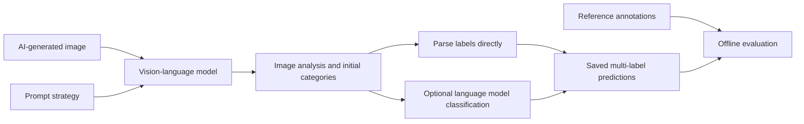

# Error Detection in AI-Generated Images

An independent undergraduate research project exploring how vision-language models identify visual errors and distinguish unusual or fantastical content within AI-generated images.

**Original research:** July 2024–May 2025 · **Repository cleanup and offline audit:** November 2026

The project combines a small annotated dataset, prompt experiments, a vision-to-language-model pipeline, and multi-label evaluation. The repository includes a dependency-free way to recompute archived predictions and documents the limitations found during the audit.

## Project at a glance

| Component | Scope |
| --- | --- |
| Dataset | 90 manually annotated images collected from Reddit r/aiArt |
| Labels | `wrong`, `weird`, `unrealistic`, `other`; multiple labels allowed, with `other` exclusive |
| Historical models | Llama 3.2 Vision through Groq; Llama 3.3 70B for text-based classification |
| Recorded experiment settings | 19 prompt or pipeline settings in the historical score records |
| Reproducible archives here | 8 complete prediction files; 4 mixed/duplicate logs excluded; 7 experiment logs not found |
| Main contributions | Task definition, annotation, API integration, prompt comparisons, evaluation and error analysis |

These are pretrained-model inference experiments. Model training or fine-tuning was not part of the implemented project.

## Method



Prompt comparisons included fixed questions, model-generated or rephrased questions, empty-output retries, and two-stage vision/text classification. The score records cover 19 settings, which are not 19 independent algorithms. The archived scripts capture selected historical variants, not a complete executable specification of every experiment.

## Quick start: recompute the results

Use Python 3.10 or newer from the repository root. No API key, image downloads, external packages, or network connection are needed.

```sh
python -m image_error_eval compare
python -m image_error_eval evaluate --predictions results/predictions/test_19.json
python -m unittest discover -s tests -v
```

`compare` writes [results/comparison.md](results/comparison.md) and [results/summary.json](results/summary.json). The JSON includes per-label precision/recall/F1, support, TP/FP/FN/TN, macro/micro F1, Hamming loss, empty predictions, and violations of the exclusive-`other` rule.

The evaluator aligns by filename and rejects duplicate filenames, missing or extra images, unknown labels, and invalid annotations. Empty historical predictions and conflicting predicted label combinations are preserved and counted. Undefined precision, recall, and F1 use zero.

## Selected historical results

All rows use the same 90-image exploratory dataset. No new model calls were made during repository preparation.

| Method | Exact match | Macro-F1 | `wrong` F1 | Empty predictions |
| --- | ---: | ---: | ---: | ---: |
| Constant `other` baseline | 37.78% | 0.1371 | 0.0000 | 0 |
| test 7: three simple questions and analysis | 25.56% | 0.5324 | 0.3784 | 14 |
| test 17: text-model handling of empty labels | 30.00% | 0.3598 | 0.0000 | 0 |
| test 19: three-question vision/text pipeline | 27.78% | 0.5147 | 0.2051 | 0 |

The constant baseline obtains higher exact match because 34 images have only `other` as their reference label, while its ability to detect the other classes is zero. Macro-F1 exposes this weakness. Test 19 improves some class scores relative to test 7 while reducing `wrong` and `weird` F1. The results support discussion of trade-offs, not a claim of reliable error detection or consistent improvement.

## What the audit found

- **Parsing affects results.** The historical comma-based parser can drop a valid first label after a Markdown `Categories` heading. Saved predictions are preserved; they have not been silently repaired.
- **Some logs contain appended executions.** Four files contain 107, 270, 131, and 109 records for 90 unique images. They are excluded from the automated comparison. See [provenance](data/provenance.json).
- **Live regeneration is unavailable on the original service.** Groq retired the two Llama 3.2 Vision preview model IDs on April 14, 2025. [Official deprecation notice](https://console.groq.com/docs/deprecations).
- **The dataset is small and exploratory.** Labels overlap conceptually, class frequencies differ, and prompts were compared on the same data. There is no established independent held-out evaluation, inter-annotator agreement, repeated-run uncertainty, or demonstrated generalization.
- **Not every experimental setting is fully recoverable.** Per-run models, prompts and sampling settings were not consistently saved. No missing metadata is inferred from the final source files.

See [docs/research-notes.md](docs/research-notes.md) for details and next steps.

## Repository contents

```text
image_error_eval/       Offline evaluator and command-line entry point
data/                  Annotations, data notes and provenance manifest
results/predictions/   Eight complete archived parsed-prediction files
results/               Recomputed metrics and comparison table
legacy/                Three credential-free historical inference scripts
docs/                  Method, limitations, attribution and audit notes
tests/                 Metric, integrity and historical regression checks
```

The [legacy scripts](legacy/README.md) are research references using retired model IDs. The supported runnable workflow in this repository is offline evaluation.

## Data, attribution and reuse

Original Reddit images, downloaded images, third-party papers, and image-containing slides are not distributed. The annotations and predictions can be used to inspect the evaluation without obtaining the original images; see [data/README.md](data/README.md).

Data collection used [RaccoonTamer/Reddit-Crawler](https://github.com/RaccoonTamer/Reddit-Crawler), a third-party tool. Its code is not included and is not claimed as original work. See [attribution and reuse notes](docs/attribution.md). An open-source license for the project's original code has not been selected.
